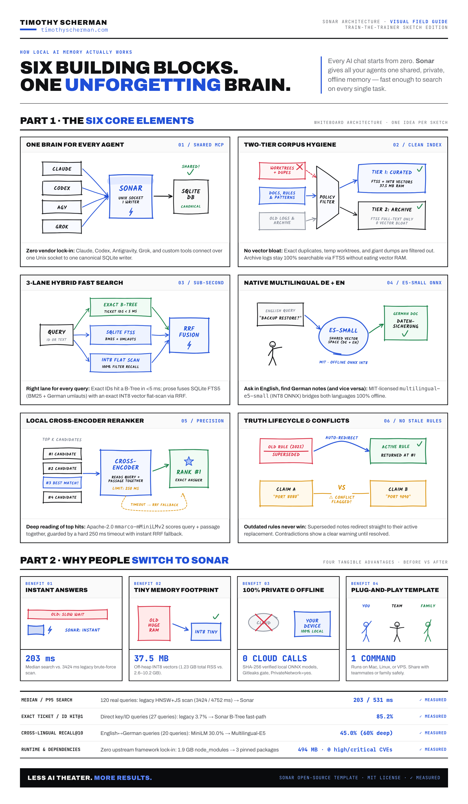

# SONAR

**One shared, 100% offline long-term memory for every AI agent you use — Claude Code, Codex, Antigravity, Grok, and any MCP client.**

> **Less AI theater. More results.** Built for daily production work, measured on real corpora, zero cloud calls, zero vendor lock-in.

---

## Why Sonar Exists (In Plain English)

Every time you open a new AI chat or switch from Claude to Codex or Grok, your AI starts with **amnesia**. You re-explain past decisions, architecture rules, bug fixes, and preferences over and over again.

And if you try to plug in a cloud memory tool or a bloated vector framework, you quickly hit four real-world walls:

1. **Privacy leaks** — your notes, client context, and code snippets leave your machine.
2. **Slow, noisy search** — searching thousands of Markdown notes takes 3–5 seconds, misses exact ticket IDs, and fails when you ask in English about a German document.
3. **Stale truths** — old rules keep outranking newer decisions, so agents follow outdated instructions.
4. **Heavy RAM & brittle dependencies** — gigabytes of `node_modules` and memory-hungry vector graphs crash small servers or laptops.

**Sonar solves all four.** It runs as one tiny local service on your Mac, Linux machine, or private server. Every AI harness plugs into it via standard **MCP (Model Context Protocol)** over a single Unix socket.

---

## How Sonar Works — Visual Field Guide



---

## Quick Start (1-Command Setup for You, Your Team, or Family)

Sonar is designed as a clean, plug-and-play template. Zero private rules or personal paths are hardcoded — your own folders and rules live strictly in `~/.config/sonar/`.

### Requirements
- **Node.js 22+** (tested on Node `24.x`)
- **Python 3.9+** (for the lightweight zero-dependency MCP stdio proxy and `node-gyp`)
- **C/C++ build toolchain** (`Xcode Command Line Tools` on macOS, or `build-essential` on Linux) for compiling `better-sqlite3` from source by default (`SONAR_BUILD_FROM_SOURCE=1`; opt-in `SONAR_BUILD_FROM_SOURCE=0` runs `prebuild-install` to fetch unpinned GitHub release binaries without SHA-256 verification and is not recommended)
- Optional: **Gitleaks 8.19+** binary (required for the `gitleaks dir` subcommand) for secret screening before indexing

### 1. Clone and Install
```bash
git clone https://github.com/Tomi2k/sonar-memory.git
cd sonar-memory
./scripts/install.sh
```

What `install.sh` does:
1. Installs the **3 pinned production dependencies** (`better-sqlite3`, `@huggingface/transformers`, `zod` — 0 high/critical CVEs) with `npm ci --omit=dev --ignore-scripts`, compiles `better-sqlite3` from source by default via `node-gyp` (`npm run build-release`), and smoke-tests the lockfile-verified bundled `onnxruntime-node` CPU native bindings. (If installing manually instead of using `./scripts/install.sh`, always pass `--ignore-scripts` and run `cd node_modules/better-sqlite3 && npm run build-release`; `.npmrc` is intentionally gitignored so local registry tokens are never committed.)
2. Runs the full unit and contract test suite (`npm test`).
3. Downloads the two commit-pinned, open-license offline ONNX INT8 models (**MIT** `Xenova/multilingual-e5-small` + **Apache-2.0** `cross-encoder/mmarco-mMiniLMv2-L12-H384-v1`) and verifies every weight, tokenizer, and config file's **SHA-256** checksum against `models/manifest.json`.
4. Initializes an empty `memory.db` schema and creates `~/.config/sonar/config.json` and `~/.config/sonar/policy.json` (mode `0600`).
5. Installs `~/.local/bin/sonar`, `~/.local/bin/sonar-mcp`, and `~/.local/bin/sonar-check`.

### 2. Point Sonar at Your Markdown Folders
Edit `~/.config/sonar/config.json` and add the folders you want indexed (omitted `database`/`index`/`modelRoot`/`socket` keys default to `~/.local/share/sonar/*`; avoid indexing untrusted third-party repositories unless needed):
```json
{
  "sources": [
    "/Users/you/notes"
  ]
}
```

### 3. Build the Initial Index & Start the Service
```bash
node --expose-gc ingest/reindex.mjs --config ~/.config/sonar/config.json
node --expose-gc server/mcp-server.mjs ~/.config/sonar/config.json
```

Verify health in another terminal:
```bash
sonar-check
# [SONAR-OK] sonar-v1 bereit (...)
```

---

## Connect Any AI Harness (Claude, Codex, Antigravity, Grok)

Every agent connects through the exact same thin stdio proxy (`~/.local/bin/sonar-mcp`), talking to the single local daemon over Unix socket:

### Claude Code (`~/.claude.json`)
```json
{
  "mcpServers": {
    "sonar": {
      "type": "stdio",
      "command": "/Users/you/.local/bin/sonar-mcp",
      "args": []
    }
  }
}
```

### Codex (`~/.codex/config.toml`) & Grok (`~/.grok/config.toml`)
```toml
[mcp_servers.sonar]
command = "/Users/you/.local/bin/sonar-mcp"
args = []
```

### Antigravity CLI (`~/.gemini/config/mcp_config.json`)
```json
{
  "mcpServers": {
    "sonar": {
      "command": "/Users/you/.local/bin/sonar-mcp",
      "args": []
    }
  }
}
```

### Automatic Session-Start Health Check
Never start a session with a dead memory backend again. Add `sonar-check --hook` to your shell startup (`.zshrc` / `.bashrc`) or Claude `SessionStart` hooks:
```bash
# Prints nothing when healthy (<20 ms local socket, 20 s cache for SSH).
# Immediately prints an informational [SONAR-DOWN] notice if unreachable.
sonar-check --hook
```

---

## Real Measured Benchmarks (`✓ measured`)

Every number below was measured on a real production corpus (**22,485 deduplicated documents** / **321,906 chunks** / **101,330 curated INT8 vectors**, mixed German & English engineering, documentation, and decision records) across **120 authentic queries** (27 exact IDs, 35 German, 20 English, 20 cross-lingual DE↔EN, 10 project-filtered, 8 multi-topic reference queries) on an 8-core x86_64 Linux server (`Node 24.x`, `SQLite 3.x`).

| Metric (120 Queries) | Legacy HNSW + JS BM25 (`MiniLM` FP32) | Sonar `P2` (`MiniLM` INT8 + FTS5) | Sonar `P5` (`E5-small` INT8, Rerank Off) | Sonar **Live Default** (`E5-small` + Cross-Encoder `K=8`) | Sonar **`deep` Mode** (`E5-small` + Cross-Encoder `K=20`) |
|---|---:|---:|---:|---:|---:|
| **Median Latency (`p50`)** | 3,424 ms | **94 ms** | **100 ms** | **203 ms** *(16.9x faster)* | 313 ms |
| **`p95` Latency** | 4,752 ms | **315 ms** | **317 ms** | **531 ms** *(8.9x faster)* | 565 ms |
| **Max Latency** | 9,288 ms | 433 ms | 389 ms | **638 ms** *(14.6x faster)* | 651 ms |
| **Overall `nDCG@5`** | 0.6087 | 0.7255 | 0.8129 | **0.8254** *(+0.217)* | **0.8466** *(+0.238)* |
| **Overall `nDCG@10`** | 0.6291 | 0.7518 | 0.8204 | **0.8328** *(+0.204)* | **0.8550** *(+0.226)* |
| **Exact Ticket/ID `Hit@1`** | 3.7% *(p95 2,659 ms)* | **85.2%** *(p95 22 ms)* | **85.2%** *(p95 21 ms)* | **85.2%** *(p95 26 ms)* | **85.2%** *(p95 21 ms)* |
| **German `DE→DE nDCG@5`** | 0.7037 | 0.7743 | 0.9409 | **0.9532** | **0.9798** *(97.1% Hit@1)* |
| **English `EN→EN nDCG@5`** | 0.8705 | 0.9315 | 0.9465 | **1.0000** *(100% Hit@1)* | **1.0000** *(100% Hit@1)* |
| **Cross-Lingual `nDCG@10`** | 0.2246 *(30% R@10)* | 0.2790 | 0.3545 | **0.4315** *(+92%)* | **0.5500** *(60% R@10)* |
| **Vector RAM (Off-Heap)** | 809 MB HNSW + 686 MB f32 | **37.5 MB** | **37.5 MB** | **37.5 MB** *(−97%)* | **37.5 MB** |
| **Live Service Peak RSS** | 2.6–10.2 GB | 428 MB | 756 MB | **1.23 GB** *(both ONNX preloaded)* | 1.13 GB |
| **Install Footprint (`node_modules`)** | 1.9 GB | **494 MB** *(0 high/critical CVEs)* | **494 MB** | **494 MB** | **494 MB** |

*Note: All metrics above were measured directly by `eval/harness.mjs` against the live Unix socket and index generations. Results on your machine depend on corpus size, CPU SIMD support (AVX-512 / Apple Silicon), and disk speed.*

---

## Technical Deep Dive

### 1. Architecture & Process Isolation
- **Single-Writer Canonical Store (`core/store/canonical.mjs`):** All durable memories, relations (`supersedes`, `contradicts`), and a monotonic `sonar_changes(seq)` journal live in one SQLite WAL database (`memory.db`). `memory_retrieve` and `memory_list` always read canonical SQLite directly (**0 ms stale reads**). New/updated entries since the last index build are blended into `memory_search_unified` via a live delta overlay (**0 ms stale search**).
- **Worker-Thread Search Engine (`server/worker.mjs`):** Embeddings, INT8 vector scans, FTS5 queries, and cross-encoder inference execute inside a dedicated `worker_thread` so the MCP HTTP/Unix-socket event loop never blocks.
- **Separated Atomic Index Builder (`ingest/builder.mjs`):** Builds derived immutable generations (`generation-<model>-<fingerprint>/`) containing `index.db` + `vectors.i8` + `scales.f32`, validates `PRAGMA quick_check`, swaps `CURRENT` atomically, and hot-reloads the live server without restart. Unchanged corpora short-circuit via fingerprint skip.

### 2. Three-Lane Hybrid Retrieval (`core/search/engine.mjs`)
1. **Exact Key B-Tree Fast-Path (`chunk_keys`):** Detects ticket IDs (`BUG-1042`, `FEAT-2099`), entry IDs, and exact filenames in `< 5 ms` — bypassing embedding and reranking completely.
2. **SQLite FTS5 + German Umlaut Folding (`core/normalize.mjs`):** Indexes both exact (`2x` weight) and stemmed (`1x` weight) tokens with consistent `ä↔ae`, `ö↔oe`, `ü↔ue`, `ß↔ss` folding, plus a lean identifier trigram table (`fts_ident`).
3. **Exact INT8 Flat-Scan (`core/search/vector-scan.mjs`):** Symmetric per-vector INT8 quantization (`>0.999` cosine fidelity, 384 bytes/vector off-heap `Int8Array`), 8x-unrolled V8 dot product, 100% exact metadata/project filter recall (zero HNSW post-filter drop-off), zero graph compaction overhead.

### 3. Truth Lifecycle & Conflict Workflow (`core/store/canonical.mjs`)
- **Superseded Auto-Redirect:** `memory_supersede` marks an older canonical `memory_entries` record archived, records a `supersedes` edge (with cycle detection, target-existence verification, and secret-screened reason), and automatically redirects search hits up to 3 hops to the active successor with a `superseded_notice`. External/Markdown `own-rule` files cannot be overridden via MCP `memory_supersede`.
- **Contradiction Tracking:** `memory_store` checks key-prefix and semantic neighbors (`cosine ≥ 0.85`) and returns non-blocking `possible_conflicts`. `memory_flag_conflict` marks unresolved contradictions so search surfaces both entries with a `conflict_warning` until `memory_resolve` declares a winner.
- **Hard Purge:** `memory_purge` (requiring explicit `confirm: true`) deletes the canonical row and relations (`PRAGMA secure_delete = ON` + WAL checkpoint retry), writes a purge tombstone that immediately blocks the entry in `memory_search`, `memory_source`, and `memory_sources`, and removes older backup index generations on disk. Running `ingest/reindex.mjs --force` (or the next scheduled reindex) rebuilds the active `index.db` snapshot (`PRAGMA secure_delete = ON`), removes every pre-purge generation on disk, and prunes orphaned vectors from `embed-cache.db`.

### 4. MCP Tool Reference (16 Tools)
| Tool | Purpose |
|---|---|
| `memory_search_unified` / `memory_search` | Hybrid search (`query`, `limit`, `namespace`, `project`, `scope`, `rerank: auto\|off\|deep`, `include_history`) |
| `memory_store` | Store/upsert durable entry with secret screening, optional `supersedes`, and conflict hints |
| `memory_retrieve` | Instant canonical SQLite lookup by `(namespace, key)` |
| `memory_list` | Paginated listing of active canonical entries |
| `memory_delete` | Soft-delete with tombstone protection |
| `memory_purge` | Hard-delete (`confirm: true`): wipes canonical row/relations, blocks search/source immediately, removes prior generations |
| `memory_supersede` | Mark `old_ref` superseded by `new_ref` (cycle-checked, auto-redirecting) |
| `memory_flag_conflict` | Flag an unresolved contradiction between two entries |
| `memory_resolve` | Resolve a conflict by declaring the winner (optionally superseding the loser) |
| `memory_history` | Inspect active successor chain and relation history for a reference |
| `memory_source` / `memory_sources` | Read full original indexed source text or list indexed sources |
| `memory_stats` / `memory_bridge_status` / `memory_import_claude` | Sub-millisecond index, RAM, vector, and conflict telemetry |

### 5. CLI Usage
```bash
sonar search "how to restore backups" --limit 5 --rerank auto
sonar store --key "deploy-rule" --value "Always run quick_check before cutover" --namespace patterns
sonar supersede --old-ref "patterns/old-rule" --new-ref "patterns/deploy-rule" --reason "Updated procedure"
sonar conflict --ref-a "patterns/rule-a" --ref-b "patterns/rule-b" --reason "Conflicting port"
sonar resolve --relation-id 1 --winner-ref "patterns/rule-b"
sonar history --ref "patterns/old-rule"
sonar stats
sonar-check
```

---

## Security & Privacy Model

- **100% Offline Runtime:** `env.allowRemoteModels = false` and `local_files_only = true` in both embedder and reranker. Run under systemd `PrivateNetwork=yes` + `ProtectSystem=strict` + `NoNewPrivileges=yes` (see `deploy/sonar.service.example`).
- **Commit-Pinned SHA-256 Model Verification:** `download-models.mjs` fetches immutable 40-character Hugging Face commit revisions, and every ONNX weight, tokenizer, and config file is verified against `models/manifest.json` before loading (fail-closed). Only permissive open-source models (**MIT** and **Apache-2.0**) are accepted.
- **Trusted Root Scoping (`trustedRoots`), Trust-Weighted Ranking & Untrusted Content Framing:** Markdown files only receive `trust: "own-rule"`, non-expiring `kind: "rule"`, or same-root frontmatter `superseded_by` redirection when located inside directories explicitly listed in `trustedRoots`. Files outside `trustedRoots` are classified as `workspace-doc` (or `archive-doc`), strongly demoted via trust weights in **both** hybrid RRF (`0.55x` / `0.45x` vs `1.25x` for `own-rule` and `1.0x` for `internal-memory`) and Cross-Encoder reranking (`-1.5` / `-2.0` logit bias vs `+2.0` / `+1.0`), and flagged with `untrusted: true` plus `content_warning` in `memory_search`, `memory_source`, and `memory_sources` outputs. Soft trust weighting reduces prompt-injection priority on comparable matches rather than hard-blocking untrusted passages, so avoid indexing untrusted third-party repositories unless you actually need them.
- **Persistent Memory Write Guard:** `memory_store`, `memory_supersede`, `memory_resolve`, `memory_delete`, and `memory_purge` carry `destructiveHint: true` in MCP annotations. By default, the MCP daemon sets `"allowMcpRuleMutations": false` (`config.json`), blocking any MCP mutation of `kind: "rule"` or `provenance_type: "user_claim"` entries at the server boundary even if an MCP client auto-approves `destructiveHint: true` tools. Operators who explicitly enable `"allowMcpRuleMutations": true` still require explicit `confirm_rule_write: true` or `confirm_rule_supersede: true` for creating, overwriting (including archived or soft-deleted entries), deleting, purging, or superseding `kind: "rule"` or `user_claim` entries (which then depends on the MCP client prompting the user on `destructiveHint: true` tools). Tags and metadata (capped at `16 KiB`) pass through the same secret screening gate as `value`.
- **Secret Screening Gate:** `core/secret-screen.mjs` integrates **Gitleaks 8.19+** (`gitleaks dir --exit-code 99`, versioning both binary version and `gitleaks.toml` hash in its cache key) and fails closed on any non-zero/non-99 exit, missing/invalid JSON report, or missing/unreadable `SONAR_GITLEAKS_BIN` / `SONAR_GITLEAKS_CONFIG`; when no binary is configured, it warns on `stderr` and applies an expanded built-in regex gate.
- **Strict RPC Schema Validation:** All 16 MCP tools validate incoming `params.arguments` with `zod` at the daemon boundary (enforcing types, bounds, and length limits before touching SQLite or the worker).
- **Zero Telemetry:** No analytics, no remote pings, no external fonts or SaaS calls.
- **Clean Repo Separation:** Personal exclusion patterns, project rules, and private evaluation suites live strictly outside the repository (`~/.config/sonar/policy.json`, `config.json`).

---

## Configuration & Custom Policy

Copy `examples/config.example.json` and `examples/policy.example.json` to `~/.config/sonar/` (leading `~/` paths are expanded automatically).

In `policy.json`, you can customize:
- `trustedRoots` — explicit directories whose rule documents (`policies/`, `rules/`, `CLAUDE.md`, `AGENTS.md`) are trusted as non-expiring `own-rule` entries (empty by default).
- `extraSkipDirs` — folder names to ignore completely (in addition to `.git`, `node_modules`, `vendor`, `.venv`, `dist`, `build`, `.expires`-tagged temp folders, and git worktrees).
- `extraWorktreeDirPatterns` — regexes for mirrored ephemeral worktree copies.
- `extraArchivePatterns` — folders indexed in Tier 2 (**FTS5 full-text only, 0 vector RAM**).
- `extraCoreCuratedPatterns` — high-priority rule/handbook paths guaranteed Tier 1 vectors.
- `projectRules` — regex rules mapping file paths to `project` metadata tags.

For Linux servers, see `deploy/sonar.service.example`, `deploy/sonar-reindex.service.example`, and `deploy/sonar-reindex.timer.example`. For macOS, see `deploy/com.sonar.daemon.plist.example`.

---

## Limits & Tested Environment

- **Tested Platforms:**
  - macOS (Apple Silicon, Node `24.x`, Python `3.12+`)
  - Ubuntu Linux x86_64 (AVX-512 capable host, Node `24.x`, SQLite `3.x`, systemd)
- **Scale Target:** INT8 flat-scan is ideal up to **~250,000 curated vectors** (`< 100 MB` RAM, exact filter recall). Beyond ~500k curated vectors, shard by namespace or swap in an ANN index.
- **Dependencies:** 3 runtime npm packages (`better-sqlite3`, `@huggingface/transformers`, `zod`). Always install via `./scripts/install.sh` (or `npm ci --omit=dev --ignore-scripts` followed by `cd node_modules/better-sqlite3 && npm run build-release`) rather than bare `npm install` so transitive postinstall hooks never run; `.npmrc` is intentionally gitignored to avoid accidental auth-token commits. `install.sh` compiles `better-sqlite3` from source via `node-gyp` by default (`SONAR_BUILD_FROM_SOURCE=1`; opt-in `SONAR_BUILD_FROM_SOURCE=0` runs `prebuild-install` to fetch unpinned GitHub release binaries without SHA-256 verification).
- **Reranker Latency Budget:** On heavily loaded CPUs, `rerank: "auto"` enforces a strict `250 ms` deadline and falls back cleanly to hybrid RRF rankings so agent sessions never stall.

---

## License

MIT License — Copyright (c) 2026 [Timothy Scherman](https://timothyscherman.com). See [LICENSE](LICENSE).

---

Built by **Timothy Scherman** ([timothyscherman.com](https://timothyscherman.com)). Less AI theater. More results.
